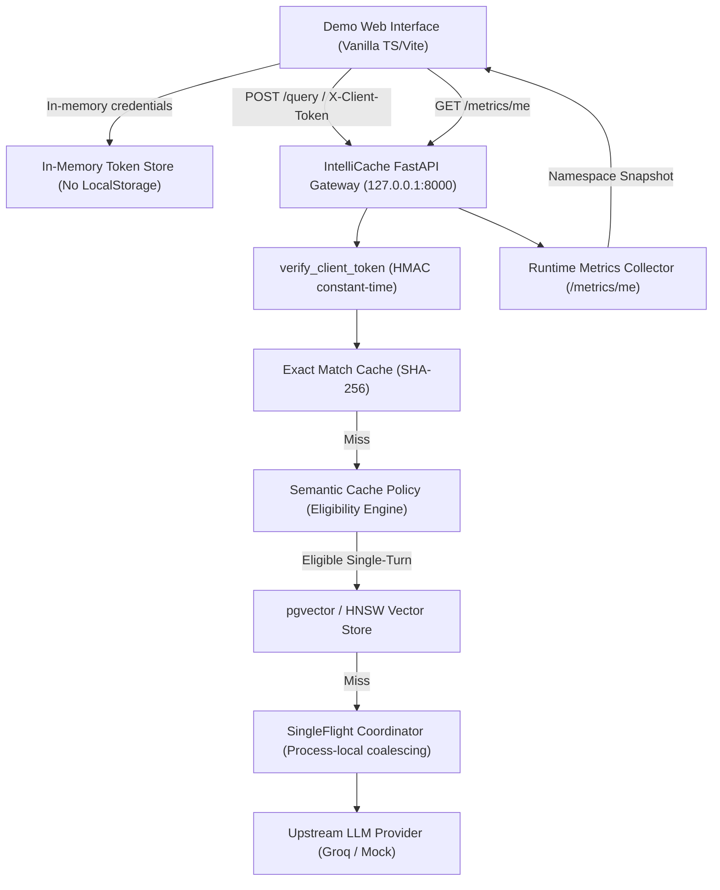

# IntelliCache Gateway Demonstration Chatbot

A standalone web application demonstrating real-time cache behavior, exact matching, semantic similarity response caching, process-local request coalescing, and namespace-isolated metrics for the IntelliCache LLM gateway.

---

## 1. Architecture Overview



### Key Architectural Principles

1. **Zero External Framework Dependencies**: Built with vanilla TypeScript, semantic HTML5, and responsive CSS bundled by Vite. No heavy UI framework (React, Vue) overhead.
2. **Strict In-Memory Credential Hygiene**: Client API tokens are held strictly in private closures within the `GatewayApiClient` instance. They are **never** persisted to `localStorage`, `sessionStorage`, `IndexedDB`, or cookies.
3. **Transparent Caching Diagnostics**: Responses display the exact backend diagnostic metadata (`cached`, `cache_type: "exact" | "semantic" | "none"`, `latency_ms`, `cache_hit_count`, `model`, `usage`, and shortened `fingerprint`). No fabricated cache indicators.
4. **Namespace-Isolated Telemetry**: The UI polls `GET /metrics/me` using the authenticated client token to display namespace-level hit rates, token savings, coalesced joins, and latency distributions. Administrative metrics (`/admin/metrics`) remain isolated and unreachable to ordinary client tokens.

---

## 2. Prerequisites & Quickstart

### Step 1: Start the IntelliCache Gateway

Ensure your Python virtual environment has the required dependencies and start the FastAPI service:

```bash
cd gateway
# Configure environment variables (or create gateway/.env)
export GROQ_API_KEY="your-groq-api-key"              # or mock key for testing
export CLIENT_API_TOKENS='{"demo-token": "default", "tenant-alpha": "tenant_alpha"}'
export CORS_ORIGINS="http://localhost:5174,http://127.0.0.1:5174,*"
export CACHE_BACKEND="memory"                        # or "postgres" with DATABASE_URL
export SEMANTIC_CACHE_ENABLED="false"                # or "true" with pgvector and Ollama

# Start the gateway server on 127.0.0.1:8000
.venv/bin/python -m uvicorn app.main:app --host 127.0.0.1 --port 8000 --reload
```

Verify that the gateway is running:

```bash
curl http://127.0.0.1:8000/
# Expected: {"service":"IntelliCache Gateway","version":"1.0.0","status":"online",...}
```

### Step 2: Start the Demonstration Web Application

In the root repository directory:

```bash
# Start Vite development server for the demo chatbot (port 5174)
pnpm demo:dev
```

Open your browser at:

```
http://localhost:5174
```

### Production Build & Preview

```bash
# Build production bundle to dist-demo/
pnpm demo:build

# Preview built application locally
pnpm demo:preview
```

---

## 3. Configuring Connection & Client Authentication

1. **Gateway REST API URL**: Set to `http://127.0.0.1:8000` (default) or your remote gateway address.
2. **Client API Token**: Enter a configured client token (e.g. `demo-token` from `CLIENT_API_TOKENS`).
3. Click **"Connect / Test"**:
   - The application checks reachability against `GET /`.
   - The application verifies authentication by querying `GET /metrics/me`.
   - Once verified, the status indicator turns green (`Connected: default`) and the initial namespace metrics are loaded.

---

## 4. Cache Demonstration Verification Workflows

### A. Demonstrating Exact-Match Cache Hits

1. In the chat interface, ensure **"Single-Turn (Semantic Eligible)"** mode is selected.
2. Click the quick prompt:
   ```
   Explain Python asyncio event loop and tasks
   ```
3. Click **Send (↵)**.
   - **First Turn (Cache Miss)**: Upstream provider generation executes.
   - Badge displays `🌐 Upstream Provider Generation` (amber/gray).
   - Latency will typically be **800 ms - 2,500 ms**.
   - Note the generated SHA-256 fingerprint (e.g. `a3f9c2...`).
4. Click **Send (↵)** again with the identical text.
   - **Second Turn (Exact Cache Hit)**: Gateway matches exact canonical hash.
   - Badge displays `⚡ Exact Cache Hit` (emerald green).
   - Latency drops to **~2 ms - 15 ms** (>98% latency reduction).
   - Hit count increments to `1` (or higher).
   - Token usage indicates cached savings.

### B. Demonstrating Semantic Similarity Cache Hits

_(Requires `CACHE_BACKEND=postgres`, `SEMANTIC_CACHE_ENABLED=true`, and running Ollama embedding provider)_

1. Submit a base technical query:
   ```
   What is the difference between let, const, and var in JavaScript?
   ```
   - First submission results in an upstream provider generation and indexes the vector embedding in `pgvector`.
2. Submit a paraphrased variation of the question:
   ```
   How do let, const, and var differ in JavaScript?
   ```
3. **Outcome (Semantic Reuse)**:
   - Gateway vector search identifies the candidate within cosine distance `< 0.08` (similarity `> 0.92`).
   - Badge displays `🧠 Semantic Cache Hit` (vibrant cyan).
   - Latency drops to **~20 ms - 60 ms** (embedding lookup time) compared to multiple seconds of LLM generation.
   - Telemetry increments `semantic_hits` in the Namespace Telemetry panel.

### C. Demonstrating Cache Bypass

1. Check the **"Bypass Cache (Force Upstream Call)"** box.
2. Submit an identical query that was previously cached.
3. **Outcome**: The gateway bypasses local and vector caches, issuing a fresh upstream LLM generation. The response badge shows upstream provider generation.

---

## 5. Technical Constraints & Policies

### 1. Process-Local SingleFlight Request Coalescing

IntelliCache implements process-local SingleFlight consolidation using Python `asyncio.Future` coordination:

- Concurrent identical requests within the same FastAPI process share a single in-flight leader execution.
- SingleFlight is strictly **process-local** (in-memory within a single worker process); it does not coordinate across separate physical server nodes without a distributed broker.

### 2. Multi-Turn Semantic Cache Exclusion Policy

- IntelliCache backend policy evaluates semantic similarity **strictly on independent single-turn technical queries**.
- Multi-turn conversation requests (where `messages` count > 1 or `conversation_id` is supplied) are **explicitly excluded from semantic caching** to avoid contextual ambiguity and hallucinations resulting from missing conversational history.
- Exact-match caching remains fully active for multi-turn requests if the exact message sequence and conversation context match.

### 3. Cross-Origin Resource Sharing (CORS) Configuration

When running the gateway and demo on different ports (e.g. gateway on `8000` and demo on `5174`):

- Ensure `CORS_ORIGINS` in `gateway/.env` includes `http://localhost:5174,http://127.0.0.1:5174` or `*`.
- When `CORS_ORIGINS=*`, the gateway permits non-credentialed client token requests via `X-Client-Token`.
