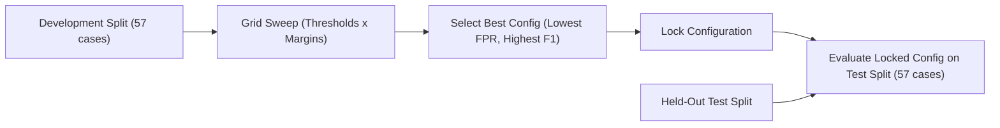

# IntelliCache Semantic Cache Evaluation & Benchmarking Methodology

This directory contains version-controlled synthetic evaluation cases and documentation for measuring the correctness, candidate ambiguity, safety, and runtime latencies of the IntelliCache semantic caching pipeline.

## 1. Dataset Structure & Validation Rules

The evaluation dataset is located at [`gateway/evaluation/dataset.json`](file:///home/gnx/Projects/IntelliCache/gateway/evaluation/dataset.json) (SHA-256 tracked in all generated reports).

### Validation Invariants Enforced by `load_dataset()`

1. **Unique Case IDs**: Every case must have a non-empty, globally unique string identifier.
2. **Valid Category & Split**:
   - Split must be strictly `"development"` or `"test"`.
   - Category must belong to the approved taxonomy: `positive_paraphrase`, `different_language`, `version_difference`, `error_difference`, `constraint_difference`, `runtime_difference`, `output_difference`, `ambiguous_candidates`, `unrelated_technical`.
3. **Non-Empty Queries & Candidates**: Every case must feature a query of length $\ge 3$ characters and at least one candidate object.
4. **Candidate Schema Integrity**: Each candidate must provide non-empty `id`, `query_text`, `cached_response`, and `answer_label` strings.
5. **Positive Case Label Grounding**: For every positive case (`expected_answer_label` is not `None`), the expected answer label **must exist** among the case's candidates.
6. **Negative Case Label Grounding**: Negative cases must explicitly set `expected_answer_label` to `None`.
7. **Strict Split Disjointness**: The set of IDs in `"development"` and `"test"` must be strictly disjoint ($\text{dev} \cap \text{test} = \emptyset$).
8. **No Silent Repair**: Any validation failure raises an immediate `ValueError`.

> [!IMPORTANT]
> **Pilot Dataset Notice**: This dataset consists of synthetic and sanitized technical queries. It is designed for regression testing and threshold exploration, not as a statistically conclusive production benchmark. Domain labels must be reviewed before production deployment.

---

## 2. Benchmark Scope & Execution Modes

Benchmarks never fabricate similarities or assign arbitrary placeholder values. All distances and similarities are computed directly from embedding vectors generated by the active provider.

### A. Offline Component Benchmark (`--benchmark-mode component`)
- **Provider**: `DeterministicMockEmbeddingProvider`.
- **Scope**: Measures local CPU vector generation, dot-product cosine similarity calculation across candidates, and `SemanticCachePolicy.evaluate_candidates`.
- **Reporting Label**: `Synthetic/mock component timings (offline)`.
- **Constraint**: Must never be described as production latency or end-to-end semantic cache latency.

### B. Real Embedding In-Memory Evaluation (`--benchmark-mode real`)
- **Provider**: Explicitly configured live provider (e.g., `OllamaEmbeddingProvider` with `nomic-embed-text`).
- **Scope**: Measures HTTP query embedding latency, candidate document embedding, in-memory cosine ranking, and policy candidate evaluation.
- **Reporting Label**: `Real embedding provider in-memory evaluation`.
- **Constraint**: Does not claim PostgreSQL pgvector disk index scan time was measured.

### C. Optional PostgreSQL End-to-End Benchmark (`--benchmark-mode pgvector`)
- **Requirement**: Dedicated test database with `pgvector` enabled (e.g. `postgresql://gnx@127.0.0.1:5433/intellicache_test`).
- **Scope**: Writes vector records to PostgreSQL and executes `PostgresVectorStore.search()` using the `<=>` cosine distance index operator.

---

## 3. Strict Provider Fallback Policy

- When `--provider ollama` is requested, the evaluator verifies connection to the daemon.
- **No Silent Fallback**: If Ollama is unreachable, the script logs an error and exits immediately with exit code 1.
- **Explicit Fallback Opt-In**: The user may pass `--allow-mock-fallback` to explicitly permit fallback to `DeterministicMockEmbeddingProvider`.
- **Auditability**: Every generated JSON and CSV report explicitly records `embedding_provider`, `mock_embeddings_used`, and `mock_fallback_occurred`. Mock results are never presented as real embedding measurements.

---

## 4. Parameter Sweeps & Split Separation Protocol

To prevent test-set overfitting and statistical contamination:

1. **Development Sweep Only**: Grid sweeps over thresholds $[0.70 - 0.95]$ and margins $[0.01 - 0.08]$ are strictly executed on the `development` partition.
2. **Locked Held-Out Evaluation**: The chosen configuration is evaluated on the `test` split without hyper-parameter re-tuning.
3. **Degradation Remedy**: If the selected configuration performs poorly on the held-out set:
   - **DO NOT** tune hyper-parameters against the held-out test data.
   - The correct action is qualitative error analysis, gathering additional representative development cases, and re-validating on a fresh held-out set.

---

## 5. Decision Quality & Savings Accounting

### Confusion Matrix Definitions

| Classification | Condition | Description |
| :--- | :--- | :--- |
| **True Positive (TP)** | $L^* \neq \text{None}$, candidate accepted, `cand.label == L*` | Safe reuse correctly identified. |
| **False Positive (FP)** | Candidate accepted, but $L^* = \text{None}$ OR `cand.label != L*` | Hazardous reuse. Incompatible or incorrect answer served. |
| **False Negative (FN)** | $L^* \neq \text{None}$, candidate rejected by policy | Safe reuse opportunity missed (conservative rejection). |
| **True Negative (TN)** | $L^* = \text{None}$, candidate rejected by policy | Incompatible candidate correctly rejected. |

### Savings Separation

- **Safe Provider Calls Avoided**: Equal to $TP$.
- **Hazardous Provider Calls**: Equal to $FP$ (avoided upstream call, but served wrong answer).
- **Safe Tokens Saved**: Sum of `total_tokens` for $TP$ cases only.
- **Hazardous Tokens Served**: Sum of `total_tokens` for $FP$ cases (reported separately; **never** claimed as savings).
- **Zero-Defect Status**: A configuration is labeled zero-defect **only** if $FP = 0$ on the evaluated partition. When $FP > 0$, the report clearly states that false positives occurred.
