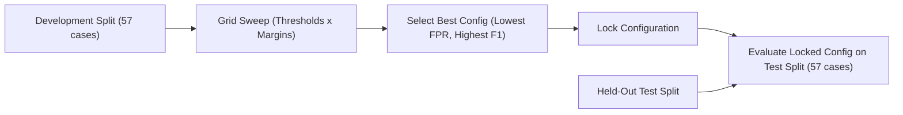

# IntelliCache Semantic Cache Evaluation & Benchmarking Methodology

This directory contains version-controlled synthetic evaluation cases and documentation for measuring the correctness, candidate ambiguity, safety, and runtime latencies of the IntelliCache semantic caching pipeline.

## 1. Dataset Structure & Validation Rules

The evaluation dataset is located at [`gateway/evaluation/dataset.json`](file:///home/gnx/Projects/IntelliCache/gateway/evaluation/dataset.json) (SHA-256 tracked in all generated reports).

### Validation Invariants Enforced by `load_dataset()`

1. **Unique Case IDs**: Every case must have a non-empty, globally unique string identifier.
2. **Valid Category & Split**:
   - Split must be strictly `"development"` or `"test"`.
   - Category must belong to the approved taxonomy: `positive_paraphrase`, `different_language`, `version_difference`, `error_difference`, `constraint_difference`, `runtime_difference`, `output_difference`, `ambiguous_candidates`, `unrelated_technical`.
3. **Non-Empty Queries & Candidates**: Every case must feature a query of length $\ge 3$ characters and at least one candidate object.
4. **Candidate Schema Integrity**: Each candidate must provide non-empty `id`, `query_text`, `cached_response`, and `answer_label` strings.
5. **Positive Case Label Grounding**: For every positive case (`expected_answer_label` is not `None`), the expected answer label **must exist** among the case's candidates.
6. **Negative Case Label Grounding**: Negative cases must explicitly set `expected_answer_label` to `None`.
7. **Strict Split Disjointness**: The set of IDs in `"development"` and `"test"` must be strictly disjoint ($\text{dev} \cap \text{test} = \emptyset$).
8. **No Silent Repair**: Any validation failure raises an immediate `ValueError`.

> [!IMPORTANT]
> **Pilot Dataset Notice**: This dataset consists of synthetic and sanitized technical queries. It is designed for regression testing and threshold exploration, not as a statistically conclusive production benchmark. Domain labels must be reviewed before production deployment.

---

## 2. Benchmark Scope & Execution Modes

Benchmarks never fabricate similarities or assign arbitrary placeholder values. All distances and similarities are computed directly from embedding vectors generated by the active provider.

### A. Offline Component Benchmark (`--benchmark-mode component`)
- **Provider**: `DeterministicMockEmbeddingProvider`.
- **Scope**: Measures local CPU vector generation, dot-product cosine similarity calculation across candidates, and `SemanticCachePolicy.evaluate_candidates`.
- **Reporting Label**: `Synthetic/mock component timings (offline)`.
- **Constraint**: Must never be described as production latency or end-to-end semantic cache latency.

### B. Real Embedding In-Memory Evaluation (`--benchmark-mode real`)
- **Provider**: Explicitly configured live provider (e.g., `OllamaEmbeddingProvider` with `nomic-embed-text`).
- **Scope**: Measures HTTP query embedding latency, candidate document embedding, in-memory cosine ranking, and policy candidate evaluation.
- **Reporting Label**: `Real embedding provider in-memory evaluation`.
- **Constraint**: Does not claim PostgreSQL pgvector disk index scan time was measured.

### C. PostgreSQL / pgvector End-to-End Benchmark (`--benchmark-mode pgvector`)
- **Provider**: Live `OllamaEmbeddingProvider` using configured model (e.g. `nomic-embed-text`).
- **Database Requirement**: Dedicated test database specified via `TEST_DATABASE_URL` (e.g. `postgresql://gnx@127.0.0.1:5433/intellicache_test`).
- **Safety Enforcement**:
  - The database name in `TEST_DATABASE_URL` **must contain `test`**.
  - Production `DATABASE_URL` is **never** used as a fallback.
  - Automatically verifies that PostgreSQL is running and the `vector` extension is installed.
  - Runs exact-cache (`001_create_cache_entries.sql`) and pgvector migrations (`001_create_vector_records.sql`, `002_create_hnsw_index.sql`) with runtime dimension checks.
- **HNSW Vector Indexing**:
  - Applies versioned migration [`002_create_hnsw_index.sql`](file:///home/gnx/Projects/IntelliCache/gateway/migrations/vector/002_create_hnsw_index.sql) creating `idx_vector_records_embedding_hnsw` on `vector_records(vector vector_cosine_ops)` with `m = 16, ef_construction = 64`.
  - Query execution plan inspection (`explain_search` using `EXPLAIN (ANALYZE, BUFFERS)`): reports whether HNSW index scan was actually selected by the query planner vs an exact B-tree/sequential scan.
  - Query plan sanitization: Embedding vector floats in execution plan output are redacted to `[vector(...)]` to avoid leaking coordinates.
  - Planner trade-offs: For small candidate datasets (< 1,000 rows), PostgreSQL planner's cost model favors B-tree or sequential scans due to low page count. At scale ($\ge 3,000$ rows), the planner chooses `Index Scan using idx_vector_records_embedding_hnsw`.
  - Retrieval accuracy: In controlled testing, HNSW ANN cosine retrieval achieves Recall@5 = 1.0 (100% overlap with exact nearest-neighbour search).
- **Foreign-Key Invariant**:
  - Exact-cache entry inserted via `PostgresCache.set()` **first**.
  - Vector record upserted via `PostgresVectorStore.upsert()` **second**.
- **Scope**:
  - Executes actual nearest-neighbour retrieval in PostgreSQL via `PostgresVectorStore.search()` using the `<=>` cosine distance index operator and exact-cache JOIN.
  - Evaluates retrieved candidates through `SemanticCachePolicy.evaluate_candidates()`.
  - Cleans up records in a `finally` block using namespace-scoped deletion (`vector_store.clear(case_ns)` and `cache.clear(case_ns)`). Never truncates or drops tables.
- **Reporting Label**: `Real Ollama embeddings with PostgreSQL/pgvector retrieval`.

---

## 3. Strict Provider Fallback Policy

- When `--provider ollama` is requested, the evaluator verifies connection to the daemon.
- **No Silent Fallback**: If Ollama is unreachable, the script logs an error and exits immediately with exit code 1.
- **Explicit Fallback Opt-In**: The user may pass `--allow-mock-fallback` to explicitly permit fallback to `DeterministicMockEmbeddingProvider`.
- **Auditability**: Every generated JSON and CSV report explicitly records `embedding_provider`, `mock_embeddings_used`, and `mock_fallback_occurred`. Mock results are never presented as real embedding measurements.

---

## 4. Parameter Sweeps & Split Separation Protocol

To prevent test-set overfitting and statistical contamination:



1. **Development Sweep Only**: Grid sweeps over thresholds $[0.70 - 0.95]$ and margins $[0.01 - 0.08]$ are strictly executed on the `development` partition.
2. **Locked Held-Out Evaluation**: The chosen configuration is evaluated on the `test` split without hyper-parameter re-tuning.
3. **Degradation Remedy**: If the selected configuration performs poorly on the held-out set:
   - **DO NOT** tune hyper-parameters against the held-out test data.
   - The correct action is qualitative error analysis, gathering additional representative development cases, and re-validating on a fresh held-out set.

---

## 5. Decision Quality & Savings Accounting

### Confusion Matrix Definitions

| Classification | Condition | Description |
| :--- | :--- | :--- |
| **True Positive (TP)** | $L^* \neq \text{None}$, candidate accepted, `cand.label == L*` | Safe reuse correctly identified. |
| **False Positive (FP)** | Candidate accepted, but $L^* = \text{None}$ OR `cand.label != L*` | Hazardous reuse. Incompatible or incorrect answer served. |
| **False Negative (FN)** | $L^* \neq \text{None}$, candidate rejected by policy | Safe reuse opportunity missed (conservative rejection). |
| **True Negative (TN)** | $L^* = \text{None}$, candidate rejected by policy | Incompatible candidate correctly rejected. |

### Savings Separation

- **Safe Provider Calls Avoided**: Equal to $TP$.
- **Hazardous Provider Calls**: Equal to $FP$ (avoided upstream call, but served wrong answer).
- **Safe Tokens Saved**: Sum of `total_tokens` for $TP$ cases only.
- **Hazardous Tokens Served**: Sum of `total_tokens` for $FP$ cases (reported separately; **never** claimed as savings).
- **Zero-Defect Status**: A configuration is labeled zero-defect **only** if $FP = 0$ on the evaluated partition. When $FP > 0$, the report clearly states that false positives occurred.

---

## 6. Latency Metrics Breakdown & Accounting Separation

To avoid penalizing cache lookup latency with write-time overhead, evaluation separates the lifecycle into two independent stages:

1. **Stage A: Candidate Indexing Latency (`indexing_latency_ms`)**:
   - Represents the write path: Document embedding + `PostgresCache.set()` + `PostgresVectorStore.upsert()`.
   - Measured once during candidate preparation.
   - **Does NOT** reduce or penalize lookup latency or safe latency saved.

2. **Stage B: Semantic Lookup Latency (`lookup_latency_ms`)**:
   - Represents the incoming query path: Query embedding + vector retrieval + policy candidate evaluation.
   - Strictly begins *after* candidate indexing completes.
   - Used for calculating latency saved:
     $$\text{safe\_latency\_saved} = \max(0, \text{original\_generation\_latency} - \text{lookup\_latency})$$

### Measured Operations

| Measurement | Scope | Includes Write Indexing? | Includes LLM Generation? |
| :--- | :--- | :--- | :--- |
| **Candidate Indexing Latency** | Document embedding + exact cache set + vector upsert | Yes (measures write setup) | No |
| **Query Embedding Latency** | HTTP request to Ollama for `EmbeddingTask.QUERY` | No | No |
| **PostgreSQL Retrieval Latency** | pgvector `<=>` index scan, filtering by model/namespace, and `cache_entries` JOIN | No | No |
| **Policy Evaluation Latency** | Threshold, margin, model identity, and parameter compatibility checks | No | No |
| **Semantic Lookup Latency** | Query Embedding + PostgreSQL Retrieval + Policy Evaluation (Stage B) | No | No |

All operations report `sample_count`, `min`, `mean`, `median (p50)`, `p95`, and `p99`.

### Per-Metric Sample Counts & Small-Sample Warnings
Because candidate indexing occurs once per candidate setup while lookup is evaluated repeatedly across benchmark iterations, each metric records its own explicit `sample_count` in `per_metric_sample_counts`. When any metric has $0 < \text{sample\_count} < 10$, a warning is included alerting that tail percentiles ($p95, p99$) may be statistically unstable.

---

## 7. Real-Model Verification & Provenance

### Mock vs Real Test Separation
- **Offline Integration Tests**: `TestMockPgvectorSemanticEvaluationIntegration` tests PostgreSQL/pgvector storage, migrations, HNSW index verification, and policy logic using `DeterministicMockEmbeddingProvider`. These tests are fast, deterministic, and run without external daemons.
- **Opt-In Real-Model Integration**: `TestRealOllamaPgvectorIntegration` tests real model embeddings via `OllamaEmbeddingProvider` with `nomic-embed-text` against live PostgreSQL/pgvector.
  - Activated strictly via environment variable: `OLLAMA_INTEGRATION_TEST=true`.
  - **Fail-Fast Guarantee**: If `OLLAMA_INTEGRATION_TEST=true` is set, failure to reach Ollama or PostgreSQL fails immediately with an `AssertionError` (no silent skipping).
  - When unset, the suite skips with an informative message.

---

## 8. Example CLI Commands

```bash
# 1. Offline mock evaluation on development split
python scripts/evaluate_semantic_cache.py --dataset evaluation/dataset.json --split development

# 2. Offline mock evaluation on held-out test split
python scripts/evaluate_semantic_cache.py --dataset evaluation/dataset.json --split test

# 3. Development-only parameter grid sweep
python scripts/evaluate_semantic_cache.py --sweep

# 4. Offline synthetic component latency benchmark
python scripts/evaluate_semantic_cache.py --benchmark --benchmark-mode component --iterations 10

# 5. Real embedding in-memory evaluation (requires Ollama)
python scripts/evaluate_semantic_cache.py --provider ollama --model nomic-embed-text --benchmark-mode real

# 6. Real Ollama + PostgreSQL/pgvector end-to-end evaluation and benchmarking
export TEST_DATABASE_URL="postgresql://gnx@127.0.0.1:5433/intellicache_test"
python scripts/evaluate_semantic_cache.py \
    --provider ollama \
    --model nomic-embed-text \
    --benchmark-mode pgvector \
    --benchmark \
    --iterations 5
```

---

## 9. Known Evaluation Limitations

1. **Synthetic Pilot Dataset**: The 114 dataset cases are carefully curated synthetic questions representing positive paraphrases and hard negatives. While structurally rigorous, they do not replace evaluation on production user traffic.
2. **Single-Turn Scope**: The current policy and dataset target single-turn programming and technical inquiries. Multi-turn conversational history is not evaluated in this step.
3. **Hardware Sensitivity**: Latency numbers for Ollama embeddings depend on CPU/GPU hardware. Measurements on development machines reflect local performance and should not be quoted as cloud production SLAs.
4. **Zero-Defect Status**: Zero defects on the 57-case test set indicates promising discrimination for tested patterns, but does not guarantee zero false positives across arbitrary unbounded natural language inputs.
