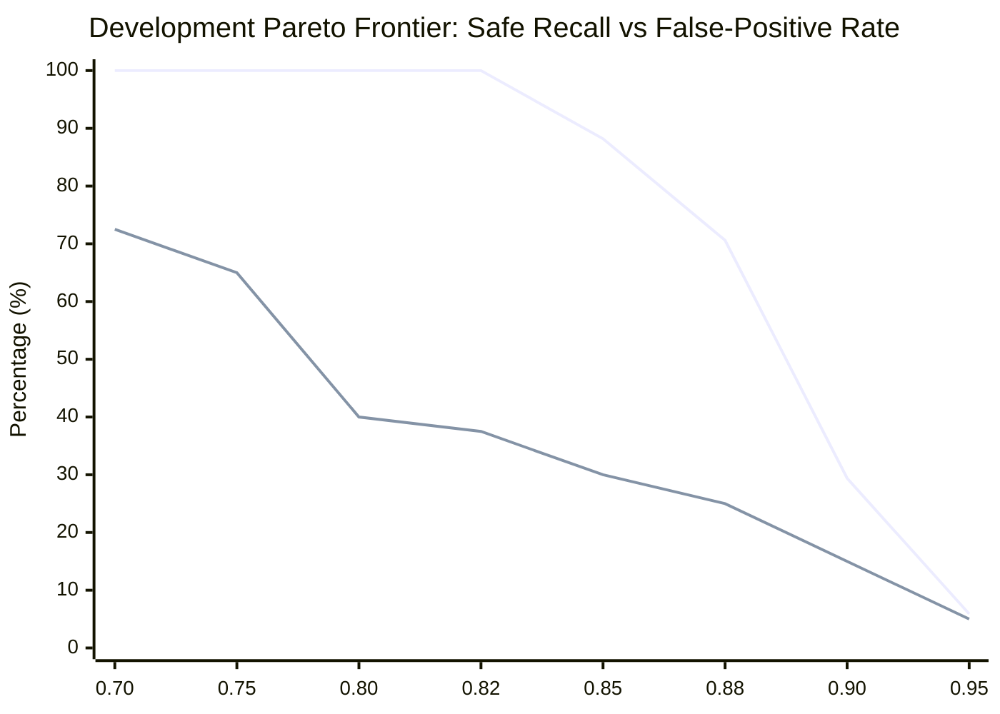

# Step 2: Controlled Semantic Cache Evaluation Report

## 1. Executive Summary & Provenance

- **Stage**: Stage 2.2.0 / 2.2.1 — Step 2: Controlled Semantic Evaluation
- **Repository**: `Guneshbari/IntelliCache`
- **Base Commit**: [`4f6a1af`](https://github.com/Guneshbari/IntelliCache/commit/4f6a1af64b8bb612f00f01ba32c8c4df29c78ecf)
- **Dataset Path**: `gateway/evaluation/dataset.json`
- **Dataset SHA-256**: `2b7a69845351f581a3d30e75eb20a98311fc5adccecb2c9aea339bec832d361b` (114 total cases: 57 development, 57 held-out test)
- **Embedding Provider**: `FastEmbedProvider` (model: `BAAI/bge-small-en-v1.5`, 384 dimensions, ONNX Runtime CPU)
- **Mock Embeddings Used**: `false`
- **Mock Fallback Occurred**: `false`
- **Canonical Execution Command**: `python scripts/evaluate_semantic_cache.py --provider fastembed --sweep --split development --output-dir evaluation/reports`

This report documents the empirical evaluation of IntelliCache's semantic caching pipeline using unmocked FastEmbed embeddings across the full development parameter sweep (40 configurations) and subsequent held-out test split validation.

---

## 2. Evaluation Harness Corrections (Step 2-A & Stage 2.2.1)

1. **Policy Model Identity Consistency**:
   - Updated `run_threshold_sweep()` in [`gateway/scripts/evaluate_semantic_cache.py`](https://github.com/Guneshbari/IntelliCache/blob/main/gateway/scripts/evaluate_semantic_cache.py) to initialize `SemanticCachePolicy` with `configured_model=provider.model_name`.
   - Ensured evaluation candidate vectors and search queries match the active provider's model identity (`BAAI/bge-small-en-v1.5`) rather than falling back to default Nomic strings.
2. **Deterministic Tie-Breaking in Threshold Sweep Selection**:
   - Added deterministic multi-key sorting in `run_threshold_sweep()` with the exact priority order:
     1. Fewer false positives (`r["fp"]` ascending)
     2. Greater recall (`-r["recall"]` descending)
     3. Greater F1 score (`-r["f1_score"]` descending)
     4. Distance from runtime default margin 0.03 (`round(abs(r["margin"] - 0.03), 4)` ascending)
     5. Higher similarity threshold (`-r["threshold"]` descending)
   - When all margins tie at threshold 0.95, margin `0.03` is deterministically selected.
   - Added automated regression test `test_threshold_sweep_tie_breaker_prefers_runtime_default_margin_0_03` in [`gateway/tests/test_evaluation.py`](https://github.com/Guneshbari/IntelliCache/blob/main/gateway/tests/test_evaluation.py).
3. **Category Breakdown Undefined Metric Handling & Count-Based F1**:
   - Implemented `compute_category_metrics()` to calculate category F1 score directly from confusion-matrix counts as $\frac{2TP}{2TP+FP+FN}$, returning `None` only when its own denominator is zero, thereby preserving valid $\text{F1}=0.0$ when $TP=0$ and $FP+FN>0$ (even if recall is undefined).
   - Represents mathematically undefined values ($0 / 0$ denominator) as `None` (`null` in JSON, rendered as `N/A` in Markdown) for precision ($TP+FP=0$), recall ($TP+FN=0$), F1 ($2TP+FP+FN=0$), and false-positive rate ($FP+TN=0$).
   - Preserves `0.0000` when the denominator is non-zero and the numerator is zero.
   - Added automated unit test `test_compute_category_metrics_undefined_handling` in [`gateway/tests/test_evaluation.py`](https://github.com/Guneshbari/IntelliCache/blob/main/gateway/tests/test_evaluation.py).
4. **Canonical Report Export**:
   - Generated canonical sweep and evaluation artifacts:
     - Development sweep CSV: [`semantic_cache_eval_20261113_173032_sweep.csv`](semantic_cache_eval_20261113_173032_sweep.csv)
     - Development baseline JSON: [`semantic_cache_eval_20261113_173032.json`](semantic_cache_eval_20261113_173032.json)
     - Development th=0.92 JSON: [`semantic_cache_eval_20261113_173056.json`](semantic_cache_eval_20261113_173056.json)
     - Held-out test th=0.92 JSON: [`semantic_cache_eval_20261113_173102.json`](semantic_cache_eval_20261113_173102.json)
     - Held-out test th=0.95 JSON: [`semantic_cache_eval_20261113_173112.json`](semantic_cache_eval_20261113_173112.json)

---

## 3. Complete Development Grid Sweep (40 Configurations)

The development split (57 cases: 17 positive paraphrases, 40 negative cases across 8 error/constraint/language categories) was swept across 8 similarity thresholds $[0.70 - 0.95]$ and 5 ambiguity margins $[0.01 - 0.08]$:

| Threshold | Margin | TP | FP | FN | TN | Precision | Recall | F1 Score | FPR | Rejection Rate | Accuracy |
| :---: | :---: | :---: | :---: | :---: | :---: | :---: | :---: | :---: | :---: | :---: | :---: |
| **0.95** | **0.03** | 1 | 2 | 16 | 38 | 0.3333 | 0.0588 | 0.1000 | 0.0500 | 0.9474 | 0.6842 |
| **0.95** | **0.02** | 1 | 2 | 16 | 38 | 0.3333 | 0.0588 | 0.1000 | 0.0500 | 0.9474 | 0.6842 |
| **0.95** | **0.01** | 1 | 2 | 16 | 38 | 0.3333 | 0.0588 | 0.1000 | 0.0500 | 0.9474 | 0.6842 |
| **0.95** | **0.05** | 1 | 2 | 16 | 38 | 0.3333 | 0.0588 | 0.1000 | 0.0500 | 0.9474 | 0.6842 |
| **0.95** | **0.08** | 1 | 2 | 16 | 38 | 0.3333 | 0.0588 | 0.1000 | 0.0500 | 0.9474 | 0.6842 |
| **0.90** | **0.03** | 5 | 6 | 12 | 34 | 0.4545 | 0.2941 | 0.3571 | 0.1500 | 0.8070 | 0.6842 |
| **0.90** | **0.02** | 5 | 6 | 12 | 34 | 0.4545 | 0.2941 | 0.3571 | 0.1500 | 0.8070 | 0.6842 |
| **0.90** | **0.01** | 5 | 6 | 12 | 34 | 0.4545 | 0.2941 | 0.3571 | 0.1500 | 0.8070 | 0.6842 |
| **0.90** | **0.05** | 5 | 6 | 12 | 34 | 0.4545 | 0.2941 | 0.3571 | 0.1500 | 0.8070 | 0.6842 |
| **0.90** | **0.08** | 5 | 6 | 12 | 34 | 0.4545 | 0.2941 | 0.3571 | 0.1500 | 0.8070 | 0.6842 |
| **0.88** | **0.03** | 12 | 10 | 5 | 30 | 0.5455 | 0.7059 | 0.6154 | 0.2500 | 0.6140 | 0.7368 |
| **0.88** | **0.05** | 12 | 10 | 5 | 30 | 0.5455 | 0.7059 | 0.6154 | 0.2500 | 0.6140 | 0.7368 |
| **0.88** | **0.08** | 12 | 10 | 5 | 30 | 0.5455 | 0.7059 | 0.6154 | 0.2500 | 0.6140 | 0.7368 |
| **0.88** | **0.02** | 12 | 11 | 5 | 29 | 0.5217 | 0.7059 | 0.6000 | 0.2750 | 0.5965 | 0.7193 |
| **0.85** | **0.03** | 15 | 12 | 2 | 28 | 0.5556 | 0.8824 | 0.6818 | 0.3000 | 0.5263 | 0.7544 |
| **0.85** | **0.05** | 15 | 12 | 2 | 28 | 0.5556 | 0.8824 | 0.6818 | 0.3000 | 0.5263 | 0.7544 |
| **0.85** | **0.08** | 15 | 12 | 2 | 28 | 0.5556 | 0.8824 | 0.6818 | 0.3000 | 0.5263 | 0.7544 |
| **0.88** | **0.01** | 12 | 12 | 5 | 28 | 0.5000 | 0.7059 | 0.5854 | 0.3000 | 0.5789 | 0.7018 |
| **0.85** | **0.02** | 15 | 13 | 2 | 27 | 0.5357 | 0.8824 | 0.6667 | 0.3250 | 0.5088 | 0.7368 |
| **0.85** | **0.01** | 15 | 14 | 2 | 26 | 0.5172 | 0.8824 | 0.6522 | 0.3500 | 0.4912 | 0.7193 |
| **0.82** | **0.03** | 17 | 15 | 0 | 25 | 0.5312 | 1.0000 | 0.6939 | 0.3750 | 0.4386 | 0.7368 |
| **0.82** | **0.05** | 17 | 15 | 0 | 25 | 0.5312 | 1.0000 | 0.6939 | 0.3750 | 0.4386 | 0.7368 |
| **0.82** | **0.08** | 17 | 15 | 0 | 25 | 0.5312 | 1.0000 | 0.6939 | 0.3750 | 0.4386 | 0.7368 |
| **0.80** | **0.03** | 17 | 16 | 0 | 24 | 0.5152 | 1.0000 | 0.6800 | 0.4000 | 0.4211 | 0.7193 |
| **0.82** | **0.02** | 17 | 16 | 0 | 24 | 0.5152 | 1.0000 | 0.6800 | 0.4000 | 0.4211 | 0.7193 |
| **0.80** | **0.05** | 17 | 16 | 0 | 24 | 0.5152 | 1.0000 | 0.6800 | 0.4000 | 0.4211 | 0.7193 |
| **0.80** | **0.08** | 17 | 16 | 0 | 24 | 0.5152 | 1.0000 | 0.6800 | 0.4000 | 0.4211 | 0.7193 |
| **0.80** | **0.02** | 17 | 17 | 0 | 23 | 0.5000 | 1.0000 | 0.6667 | 0.4250 | 0.4035 | 0.7018 |
| **0.82** | **0.01** | 17 | 17 | 0 | 23 | 0.5000 | 1.0000 | 0.6667 | 0.4250 | 0.4035 | 0.7018 |
| **0.80** | **0.01** | 17 | 18 | 0 | 22 | 0.4857 | 1.0000 | 0.6538 | 0.4500 | 0.3860 | 0.6842 |
| **0.75** | **0.03** | 17 | 26 | 0 | 14 | 0.3953 | 1.0000 | 0.5667 | 0.6500 | 0.2456 | 0.5439 |
| **0.75** | **0.05** | 17 | 26 | 0 | 14 | 0.3953 | 1.0000 | 0.5667 | 0.6500 | 0.2456 | 0.5439 |
| **0.75** | **0.08** | 17 | 26 | 0 | 14 | 0.3953 | 1.0000 | 0.5667 | 0.6500 | 0.2456 | 0.5439 |
| **0.75** | **0.02** | 17 | 27 | 0 | 13 | 0.3864 | 1.0000 | 0.5574 | 0.6750 | 0.2281 | 0.5263 |
| **0.75** | **0.01** | 17 | 28 | 0 | 12 | 0.3778 | 1.0000 | 0.5484 | 0.7000 | 0.2105 | 0.5088 |
| **0.70** | **0.03** | 17 | 29 | 0 | 11 | 0.3696 | 1.0000 | 0.5397 | 0.7250 | 0.1930 | 0.4912 |
| **0.70** | **0.05** | 17 | 29 | 0 | 11 | 0.3696 | 1.0000 | 0.5397 | 0.7250 | 0.1930 | 0.4912 |
| **0.70** | **0.08** | 17 | 29 | 0 | 11 | 0.3696 | 1.0000 | 0.5397 | 0.7250 | 0.1930 | 0.4912 |
| **0.70** | **0.02** | 17 | 30 | 0 | 10 | 0.3617 | 1.0000 | 0.5312 | 0.7500 | 0.1754 | 0.4737 |
| **0.70** | **0.01** | 17 | 31 | 0 | 9 | 0.3542 | 1.0000 | 0.5231 | 0.7750 | 0.1579 | 0.4561 |

---

## 4. Development Pareto Frontier & Configuration Selection

### Pareto Trade-off Analysis

1. **Lowest-FPR Frontier (`th=0.95, mg=0.03`)**:
   - $\text{FPR} = 5.0\%$, $\text{Recall} = 5.88\%$ ($\text{TP}=1, \text{FP}=2, \text{FN}=16, \text{TN}=38$).
   - Rejection rate: 94.74%. Reuses only 1 out of 17 valid paraphrases.
   - **Crucial Finding**: Even at 0.95, two hazardous false positives still occur (Python vs JavaScript array filtering at 0.9555, case-sensitive vs case-insensitive comparison at 0.9661).
2. **Balanced Frontier (`th=0.88, mg=0.03`)**:
   - $\text{FPR} = 25.0\%$, $\text{Recall} = 70.59\%$ ($\text{TP}=12, \text{FP}=10, \text{FN}=5, \text{TN}=30$).
   - Captures substantial paraphrase reuse, but allows 10 false positives across language and version boundaries.
3. **Full-Recall Baseline (`th=0.82, mg=0.03`)**:
   - $\text{FPR} = 37.5\%$, $\text{Recall} = 100.0\%$ ($\text{TP}=17, \text{FP}=15, \text{FN}=0, \text{TN}=25$).
   - Captures every paraphrase, but allows 15 false positives.

### Configuration Selection Decision

> [!CAUTION]
> **Safety Assessment**: Every evaluated configuration in the sweep produced false positives on development data. There is **no threshold** in the tested range $[0.70, 0.95]$ that achieves zero false positives while retaining non-zero recall.

Per the selection criteria (prioritizing lowest FP, highest recall, highest F1, margin closest to runtime default 0.03, then higher threshold):
- **Selected & Locked Configuration**: `threshold = 0.95`, `margin = 0.03`.
- **Reason for Locking**: Minimizes incorrect reuse risk ($\text{FP}=2$, $\text{FPR}=5.0\%$).
- **Caveat Recorded**: Its utility is severely impaired ($\text{Recall}=5.88\%$). Selecting this threshold demonstrates that cosine similarity alone cannot distinguish cross-lingual and constraint-inverting prompts without domain-level compatibility guards.

---

## 5. Held-Out Test Split Validation (57 Cases)

Without tuning or modifying the selected parameters, the locked configuration was evaluated against the held-out test split, alongside the baseline, mid-point, and runtime default configurations:

| Configuration | Split | TP | FP | FN | TN | Precision | Recall | F1 Score | FPR | Rejection Rate | Accuracy |
| :--- | :--- | :---: | :---: | :---: | :---: | :---: | :---: | :---: | :---: | :---: | :---: |
| **Baseline (`th=0.82, mg=0.03`)** | **Test (Held-out)** | 13 | 16 | 4 | 24 | 0.4483 | 0.7647 | 0.5652 | 0.4000 | 0.4912 | 0.6491 |
| **Mid-Point (`th=0.88, mg=0.03`)** | **Test (Held-out)** | 7 | 8 | 10 | 32 | 0.4667 | 0.4118 | 0.4375 | 0.2000 | 0.7368 | 0.6842 |
| **Runtime Default (`th=0.92, mg=0.03`)** | **Test (Held-out)** | 3 | 3 | 14 | 37 | 0.5000 | 0.1765 | 0.2609 | 0.0750 | 0.8947 | 0.7018 |
| **Locked (`th=0.95, mg=0.03`)** | **Test (Held-out)** | 2 | 0 | 15 | 40 | 1.0000 | 0.1176 | 0.2105 | 0.0000 | 0.9649 | 0.7368 |

### Test Split Category Breakdown (`th=0.95, mg=0.03`)

> [!NOTE]
> Precision, Recall, F1 Score, and False-Positive Rate can be mathematically undefined ($0/0$) when their respective denominators are zero:
> - For **positive-only categories** (such as `positive_paraphrase`), the actual negative count ($FP+TN=0$) is zero, making the False-Positive Rate ($\text{FPR} = \frac{FP}{FP+TN}$) undefined; it is reported as **N/A** in Markdown and `null` in JSON.
> - For **negative-only categories** without false positives ($TP=0, FP=0, FN=0$), positive actuals ($TP+FN=0$), predicted positives ($TP+FP=0$), and the F1 denominator ($2TP+FP+FN=0$) are zero, making Precision, Recall, and F1 mathematically undefined and reported as **N/A** in Markdown (`null` in JSON).
> - When a negative-only category contains false positives ($TP=0, FP>0, FN=0$), the F1 denominator ($2TP+FP+FN=FP>0$) is non-zero, yielding a mathematically defined $\text{F1} = \frac{0}{FP} = 0.0000$ (and Precision = 0.0000), even while Recall remains undefined (N/A).
> - Valid zero-valued metrics with non-zero denominators (e.g. $\text{FPR} = \frac{0}{5} = 0.0000$ for negative-only categories with no false positives) are strictly preserved as `0.0000`.

| Category | Total | TP | FP | FN | TN | Precision | Recall | FPR |
| :--- | :---: | :---: | :---: | :---: | :---: | :---: | :---: | :---: |
| `positive_paraphrase` | 17 | 2 | 0 | 15 | 0 | 1.0000 | 0.1176 | N/A |
| `different_language` | 5 | 0 | 0 | 0 | 5 | N/A | N/A | 0.0000 |
| `version_difference` | 5 | 0 | 0 | 0 | 5 | N/A | N/A | 0.0000 |
| `error_difference` | 5 | 0 | 0 | 0 | 5 | N/A | N/A | 0.0000 |
| `constraint_difference` | 5 | 0 | 0 | 0 | 5 | N/A | N/A | 0.0000 |
| `runtime_difference` | 4 | 0 | 0 | 0 | 4 | N/A | N/A | 0.0000 |
| `output_difference` | 4 | 0 | 0 | 0 | 4 | N/A | N/A | 0.0000 |
| `ambiguous_candidates` | 6 | 0 | 0 | 0 | 6 | N/A | N/A | 0.0000 |
| `unrelated_technical` | 6 | 0 | 0 | 0 | 6 | N/A | N/A | 0.0000 |

### Critical Statistical Caveat
While `th=0.95` observed 0 false positives across 40 negative test cases, **this is an empirical observation on this bounded sample ($N=40$ negatives), not proof of production zero-defect safety**. The development set proved that real false positives exist above 0.95 (e.g. at 0.9555 and 0.9661).

---

## 6. Detailed False Positive Error Analysis

To understand why dense embeddings fail to reject hard negatives, specific high-similarity false positives were audited:

### Case 1: Cross-Language Semantic Overlap
- **Case ID**: `neg-lang-dev-001`
- **Category**: `different_language`
- **Query**: `"How do I filter an array of numbers in Python?"`
- **Matched Candidate**: `"How do I filter an array of numbers in JavaScript?"`
- **Computed Similarity**: **`0.9555`**
- **Empirical Cause**: The sentences share 9 out of 10 words in identical order. In general-domain dense representations, language keywords ("Python", "JavaScript") occupy nearby points in the programming sub-space rather than mutually orthogonal vectors.

### Case 2: Constraint Negation / Inversion
- **Case ID**: `neg-con-dev-003`
- **Category**: `constraint_difference`
- **Query**: `"How to perform case-sensitive string comparison in Python?"`
- **Matched Candidate**: `"How to perform case-insensitive string comparison in Python?"`
- **Computed Similarity**: **`0.9661`**
- **Empirical Cause**: Negation and constraint prefixes ("sensitive" vs "insensitive") are treated as minor syntactic variations by transformer attention mechanisms when contextualized by identical surrounding phrases.

### Case 3: Breaking Version Discrepancies
- **Case ID**: `neg-ver-dev-002`
- **Category**: `version_difference`
- **Query**: `"How do I validate a field using Pydantic v2?"`
- **Matched Candidate**: `"How do I validate a field in Pydantic v1 using validator decorator?"`
- **Computed Similarity**: **`0.9333`**
- **Empirical Cause**: "v1" and "v2" represent fundamentally incompatible APIs, but dense embeddings encode them as semantically equivalent tokens describing data validation.

---

## 7. Performance & Latency Benchmarks (No LLM Calls)

Measured using `FastEmbedProvider` (`BAAI/bge-small-en-v1.5`) across 5 iterations over 57 cases (285 samples):

> [!NOTE]
> **Measurement Scope**: Captures in-process ONNX CPU embedding generation, in-memory cosine ranking, and policy candidate evaluation in Python. Does **not** include network transit, FastAPI serialization, or PostgreSQL disk index scans.

| Benchmark Metric | Samples | Min (ms) | Mean (ms) | p50 (ms) | p95 (ms) | p99 (ms) |
| :--- | :---: | :---: | :---: | :---: | :---: | :---: |
| **Query Embedding** | 285 | 3.80 | 4.72 | 4.55 | 5.81 | 6.14 |
| **Candidate Ranking** | 285 | 0.04 | 0.06 | 0.05 | 0.09 | 0.11 |
| **Policy Evaluation** | 285 | 0.004 | 0.006 | 0.006 | 0.007 | 0.010 |
| **Total Measured Lookup** | 285 | 3.88 | 4.78 | 4.61 | 5.87 | 6.21 |

- **Cold Model Initialization**: `357.24 ms` (one-time weight loading into ONNX runtime).
- **Candidate Indexing Latency**: Mean `5.92 ms` per candidate document.

---

## 8. Strategic Engineering Conclusion & Recommendations

1. **Exact Caching is Authoritative**:
   - Exact-match caching (LRU/TTL and PostgreSQL) provides 100% precision, zero-defect recall for identical queries, and sub-millisecond lookups. It must remain the default and primary cache layer.
2. **Empirical Working Hypothesis on Dense Vector Embeddings**:
   - The observed behavior indicates that **dense semantic similarity thresholding alone is not sufficient to guarantee safe reuse of technical and programming responses**.
   - This represents an **empirical finding and working hypothesis** derived from evaluating `BAAI/bge-small-en-v1.5` on this 114-case benchmark: general-purpose dense text representations prioritize overall topic context over single-token semantic constraints (such as programming language, major API version, or case-sensitivity).
3. **Recommended Production Guardrails**:
   - Do not rely on similarity threshold tuning alone to prevent hazardous false positives.
   - Introduce secondary compatibility filters (e.g. language tag matching, version extraction, or keyword fencing).
   - In the immediate term, preserve the conservative policy (`min_similarity=0.92`, `min_margin=0.03`) with semantic caching disabled by default (`SEMANTIC_CACHE_ENABLED=false`).
